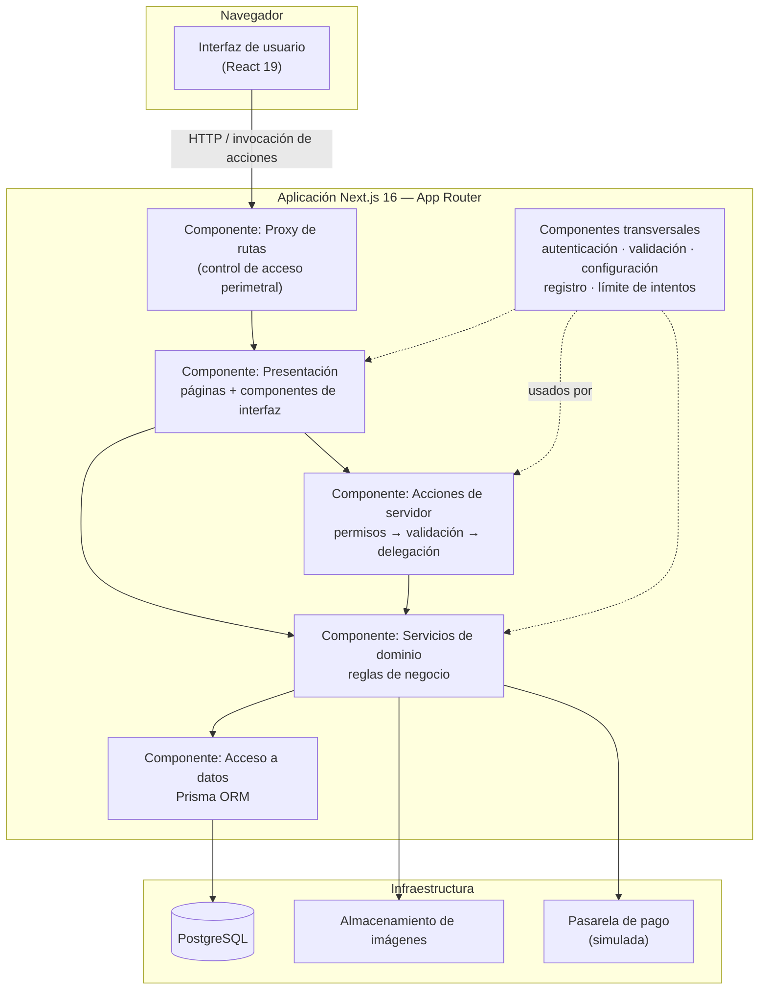
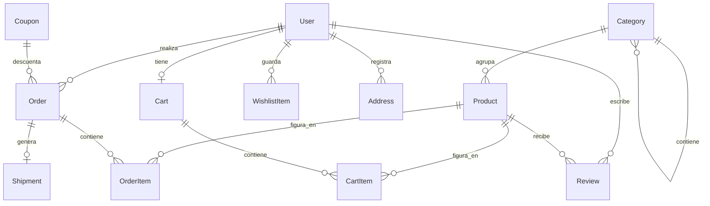

# Informe de elaboración del prototipo

**Proyecto:** Pacandé — tienda en línea
**Repositorio:** [ByManu3l/PACANDE](https://github.com/ByManu3l/PACANDE)
**Tipo de entregable:** prototipo funcional evolutivo, presentado bajo vista de componentes
**Fecha:** 10 de septiembre de 2026

Documentos que acompañan a este informe:

| Entregable                      | Archivo                                                                        |
| ------------------------------- | ------------------------------------------------------------------------------ |
| Pila de producto priorizada     | [`entrega/PACANDE_Product_Backlog.xlsx`](entrega/PACANDE_Product_Backlog.xlsx) |
| Arquitectura detallada          | [`ARQUITECTURA.md`](ARQUITECTURA.md)                                           |
| Decisiones técnicas y descartes | [`DECISIONES.md`](DECISIONES.md)                                               |
| Alcance y límites del producto  | [`QUE-INCLUYE.md`](QUE-INCLUYE.md)                                             |
| Auditoría del estado real       | [`AUDITORIA.md`](AUDITORIA.md)                                                 |

---

## 1. Introducción

### 1.1 Objetivo

Documentar cómo se construyó el prototipo de Pacandé, qué componentes lo
forman, cómo se verificó y qué queda pendiente, de manera que su estado
pueda comprobarse contra el código y no solo contra este documento.

### 1.2 Alcance del prototipo

Es un **prototipo evolutivo de alta fidelidad**: no es una maqueta
desechable, sino la primera versión del producto real. Todo lo que se ve
funciona contra una base de datos PostgreSQL: no hay pantallas simuladas
ni datos fijos incrustados para la demostración.

Una sola pieza está simulada a propósito, y está señalada como tal: la
**pasarela de pago**, que aprueba el 90 % de los intentos y no mueve
dinero. Lo que la rodea —reserva de inventario, congelado de precios,
numeración de pedidos, transacciones y reversión cuando el pago se
rechaza— sí está resuelto, porque es donde está la dificultad real.

### 1.3 Justificación del tipo de prototipo

| Alternativa                     | Por qué se descartó                                                                                                       |
| ------------------------------- | ------------------------------------------------------------------------------------------------------------------------- |
| Maqueta estática (Figma/HTML)   | Valida apariencia, no reglas de negocio. El riesgo del proyecto está en el inventario y los precios, no en el diseño.     |
| Prototipo horizontal desechable | Obligaría a reescribir todo al pasar a producto, y el plazo no lo permite.                                                |
| **Evolutivo de alta fidelidad** | Cada iteración deja código utilizable; lo construido se conserva. Coste: exige disciplina de calidad desde el primer día. |

---

## 2. Descripción general

### 2.1 Problema

Un negocio que quiere vender en línea necesita catálogo, carrito, cobro,
seguimiento de pedidos y un panel de administración propio. Las
plataformas cerradas resuelven eso a cambio de comisión por venta y de no
poder modificar el comportamiento del sistema.

### 2.2 Usuarios y roles

| Rol                                   | Qué puede hacer                                                   |
| ------------------------------------- | ----------------------------------------------------------------- |
| **Visitante**                         | Navegar el catálogo, buscar, filtrar, armar carrito y registrarse |
| **Cliente** (`USER`)                  | Comprar, ver sus pedidos, opinar, guardar favoritos y direcciones |
| **Administrador** (`ADMIN`)           | Gestionar catálogo, pedidos, envíos, cupones y moderar opiniones  |
| **Superadministrador** (`SUPERADMIN`) | Además, administrar usuarios y roles                              |

### 2.3 Alcance funcional cubierto

Catálogo en dos niveles con filtros y ordenamiento · búsqueda ·
ficha de producto con galería, valoración y relacionados · carrito
persistente que sobrevive al inicio de sesión · cupones · checkout con
direcciones guardadas y comprobante · área de cuenta (perfil, contraseña,
pedidos, favoritos, direcciones) · opiniones con moderación previa ·
panel de administración sobre catálogo, pedidos, envíos, cupones,
opiniones y usuarios.

---

## 3. Metodología de elaboración

### 3.1 Marco de trabajo

Desarrollo **iterativo e incremental** con prácticas de Scrum: pila de
producto priorizada por el valor de negocio, iteraciones cortas con
incremento utilizable al final de cada una, y revisión de la pila entre
iteraciones.

Cada iteración siguió el mismo ciclo: seleccionar las historias de mayor
prioridad → implementar → verificar → **auditar el resultado** →
replanificar. La auditoría al cierre es la particularidad del proceso: al
final de las iteraciones 1, 2 y 3 se revisó el código ya escrito buscando
defectos, código muerto e incumplimientos de las reglas del proyecto, y
los hallazgos entraron en la iteración siguiente antes que las funciones
nuevas. De ahí salieron, entre otros, cinco defectos de seguridad
corregidos en la primera auditoría.

### 3.2 Definición de «Hecho»

Una historia solo se marca `Hecho` cuando cumple **todas** estas
condiciones:

1. La funcionalidad opera de extremo a extremo contra base de datos real.
2. Tiene pruebas automáticas que cubren su regla de negocio.
3. Pasa `lint`, `typecheck`, la suite de pruebas y `build` en integración continua.
4. No introduce infracciones de accesibilidad WCAG 2.1 AA.
5. Queda documentada donde corresponde.

### 3.3 Herramientas de gestión y trazabilidad

- **Control de versiones:** Git, con mensajes bajo _Conventional Commits_
  verificados por `commitlint` en cada confirmación.
- **Trazabilidad historia → código:** cada historia de la pila cita en su
  columna de comentarios el archivo o directorio que la implementa.
- **Automatización:** `husky` formatea y pasa el linter antes de cada
  confirmación; GitHub Actions ejecuta el ciclo completo en cada envío.

---

## 4. Arquitectura del prototipo bajo componentes

### 4.1 Vista general



La flecha que **no existe** es tan importante como las que sí: ni la
presentación ni las acciones de servidor llegan a la capa de datos por su
cuenta. Siempre pasan por los servicios de dominio.

### 4.2 Catálogo de componentes

| Componente                       | Responsabilidad                                                                | Interfaz que ofrece                                                                                                                    | De qué depende                           | Ubicación                                   |
| -------------------------------- | ------------------------------------------------------------------------------ | -------------------------------------------------------------------------------------------------------------------------------------- | ---------------------------------------- | ------------------------------------------- |
| **Proxy de rutas**               | Rechazar el acceso a rutas privadas antes de renderizar nada                   | Intercepción de peticiones                                                                                                             | Configuración de autenticación           | `src/proxy.ts`                              |
| **Presentación**                 | Renderizar en servidor y recoger la entrada del usuario                        | 26 páginas y 59 componentes de interfaz                                                                                                | Servicios, acciones, validación          | `src/app/`, `src/components/`               |
| **Acciones de servidor**         | Ejecutar mutaciones invocadas desde el navegador                               | 11 módulos de acciones por dominio                                                                                                     | Guardas de rol, validación, servicios    | `src/actions/`                              |
| **Servicios de dominio**         | Contener las reglas de negocio. Única capa que consulta la base de datos       | 14 servicios (catálogo, carrito, pedidos, pagos, envíos, opiniones, cupones, favoritos, direcciones, usuarios, almacenamiento, estado) | Acceso a datos, pasarela, almacenamiento | `src/lib/services/`                         |
| **Autenticación y autorización** | Identidad, sesión y guardas de rol                                             | `requireSession`, `requireRole`                                                                                                        | Servicio de usuarios                     | `src/lib/auth/`                             |
| **Validación**                   | Un único esquema por dominio, compartido entre navegador y servidor            | 9 esquemas zod                                                                                                                         | —                                        | `src/lib/validations/`                      |
| **Acceso a datos**               | Traducir el modelo de dominio a SQL y administrar transacciones                | Cliente Prisma único                                                                                                                   | PostgreSQL                               | `src/lib/prisma.ts`, `prisma/schema.prisma` |
| **Configuración**                | Validar el entorno al arrancar y centralizar los datos de marca                | `env`, `siteConfig`                                                                                                                    | —                                        | `src/lib/env.ts`, `src/lib/config/`         |
| **Observabilidad**               | Registro estructurado con filtrado de datos sensibles y comprobación de estado | `logger`, `/api/health`                                                                                                                | Acceso a datos                           | `src/lib/logger.ts`, `src/app/api/health/`  |
| **Protección de abuso**          | Limitar intentos por operación                                                 | `rateLimit`                                                                                                                            | —                                        | `src/lib/rate-limit.ts`                     |

### 4.3 Reglas de dependencia entre componentes

1. **Solo los servicios acceden a la base de datos.** La regla se puede
   comprobar en un comando: `grep -rn "prisma\." src/app src/actions src/components`
   no debe devolver nada, y la auditoría automática falla si lo hace.
2. **Toda acción de servidor comprueba permisos antes que cualquier otra
   cosa.** Cada archivo con `'use server'` expone endpoints HTTP
   invocables desde el navegador: la comprobación del proxy no basta.
3. **El mismo esquema de validación se usa en las dos orillas.** Validar
   solo en el navegador equivale a no validar.
4. **Los componentes transversales no dependen de los de negocio**, lo que
   permite sustituir el destino del registro, el almacén del límite de
   intentos o la pasarela sin tocar los servicios.

### 4.4 Componentes sustituibles

Tres puntos del prototipo están detrás de una interfaz precisamente
porque se sabía que iban a cambiar al pasar a producción:

| Interfaz          | Implementación actual                  | Sustitución prevista         |
| ----------------- | -------------------------------------- | ---------------------------- |
| `PaymentProvider` | Pasarela simulada (90 % de aprobación) | Stripe, Wompi o Mercado Pago |
| `LogTransport`    | Consola (JSON en producción)           | Sentry o equivalente         |
| `RateLimitStore`  | Memoria del proceso                    | Redis                        |

### 4.5 Modelo de datos

13 entidades y 6 enumeraciones, con 4 migraciones versionadas.



Tres decisiones del modelo que sostienen la corrección del cobro:

- **`OrderItem` guarda el precio del momento de la compra**, no una
  referencia al precio actual del producto. Un cambio de tarifa no puede
  reescribir pedidos pasados.
- **`OrderCounter` es una entidad propia.** El número de pedido se reserva
  dentro de la transacción; dos compras simultáneas no pueden obtener el
  mismo número.
- **Los importes son `Decimal`, nunca coma flotante.** Con `Float`,
  sumar tres artículos de 0,10 no da 0,30.

---

## 5. Elaboración: iteraciones ejecutadas

| Iteración    | Objetivo                                           | Incremento entregado                                                                                                                                                                                                              | Puntos |
| ------------ | -------------------------------------------------- | --------------------------------------------------------------------------------------------------------------------------------------------------------------------------------------------------------------------------------- | ------ |
| **Sprint 1** | Que se pueda comprar de principio a fin            | Estructura del proyecto, modelo de datos, autenticación con roles, catálogo, carrito con fusión de invitado, checkout con control de inventario, área de cuenta, panel de administración, suite de pruebas e integración continua | 115    |
| **Sprint 2** | Nivel comercial y capacidad de operar              | Filtros, ordenamiento, paginación, navegación móvil, SEO, opiniones, cupones, favoritos, direcciones; validación del entorno, registro estructurado, límite de intentos y comprobación de estado                                  | 63     |
| **Sprint 3** | Cierre y verificación del prototipo                | Pantallas de administración de las funciones nuevas, paginación del panel, accesibilidad verificada, auditoría automática del repositorio, presupuesto de tamaño y documentación                                                  | 27     |
| **Sprint 4** | _(planificada)_ Requisitos de puesta en producción | Pasarela de pago real y correos transaccionales                                                                                                                                                                                   | 16     |

**Historial:** 45 confirmaciones. Al cierre de cada iteración se ejecutó
una auditoría cuyos hallazgos se atendieron antes de abrir nuevas
funciones; la traza de esas revisiones está en
[`AUDITORIA.md`](AUDITORIA.md).

### 5.1 Decisiones técnicas con su compromiso

| Decisión                                              | Restricción que la motiva                                                                  | Qué se sacrifica                                                                             |
| ----------------------------------------------------- | ------------------------------------------------------------------------------------------ | -------------------------------------------------------------------------------------------- |
| Next.js con acciones de servidor, sin API REST propia | Un solo proyecto que mantener; menos superficie que asegurar                               | Acoplamiento al framework: exponer una API móvil exigiría una capa nueva sobre los servicios |
| Sesión en JWT y no en base de datos                   | El proxy corre en entorno Edge, donde no se puede consultar el ORM                         | Revocar una sesión al instante requiere trabajo adicional                                    |
| Capa de servicios obligatoria                         | Poder probar las reglas de negocio sin levantar el servidor                                | Un archivo más por cada operación                                                            |
| Componentes de interfaz copiados al repositorio       | Poder editarlos sin depender de la versión de un tercero                                   | Las mejoras del proyecto original no llegan solas                                            |
| Producto sin variantes                                | Reduce el modelo de datos a la mitad y permitió llegar al checkout en la primera iteración | Añadir tallas o colores después atraviesa carrito, inventario, pedidos y panel               |

---

## 6. Verificación y validación

| Técnica                      | Cobertura                                                              | Dónde                             |
| ---------------------------- | ---------------------------------------------------------------------- | --------------------------------- |
| Pruebas de servicios         | Reglas de negocio contra una PostgreSQL real, sin simulaciones del ORM | `tests/unit/`                     |
| Pruebas de extremo a extremo | Compra completa, autenticación, permisos por rol, panel                | `tests/e2e/`                      |
| Pruebas de accesibilidad     | Análisis automático con axe sobre las páginas principales              | `tests/e2e/accesibilidad.spec.ts` |
| Verificación de tipos        | TypeScript en modo estricto sobre todo el proyecto                     | `npm run typecheck`               |
| Auditoría del repositorio    | Regla de capas, integridad de la documentación, código muerto          | `npm run audit`                   |
| Integración continua         | Lint, tipos, pruebas, build y presupuesto de tamaño en cada envío      | `.github/workflows/`              |

El repositorio declara **189 pruebas automáticas** (150 de servicios y 39
de navegador, incluidas 13 de accesibilidad). La cifra autoritativa es la
que reporta la ejecución: `npm test` y `npm run e2e`.

**Casos críticos verificados explícitamente:** venta simultánea del último
artículo en inventario (no se produce sobreventa); manipulación del precio
desde el navegador (el importe se relee del servidor); acceso de un
cliente a rutas de administración (denegado en proxy y en cada acción);
opinión de quien no compró el producto (rechazada); cupón vencido, agotado
o por debajo de la compra mínima (rechazado en el servidor).

---

## 7. Resultados

| Indicador                        | Valor                        |
| -------------------------------- | ---------------------------- |
| Historias de la pila de producto | 49                           |
| Historias completadas            | 41 (84 %)                    |
| Puntos de historia completados   | 205 de 294 (70 %)            |
| Páginas implementadas            | 26                           |
| Componentes de interfaz          | 59                           |
| Servicios de dominio             | 14                           |
| Módulos de acciones de servidor  | 11                           |
| Entidades del modelo de datos    | 13 (+ 6 enumeraciones)       |
| Archivos TypeScript en `src/`    | 152 (≈ 13.000 líneas)        |
| Infracciones de WCAG 2.1 AA      | 0 en las páginas principales |

El 30 % de puntos no completados corresponde íntegramente a historias
que **dependen de decisiones o contratos externos** —pasarela de pago,
proveedor de correo, definición del catálogo con variantes—, no a trabajo
técnico pendiente dentro del alcance del prototipo.

---

## 8. Pila de producto y criterio de priorización

La pila completa está en
[`entrega/PACANDE_Product_Backlog.xlsx`](entrega/PACANDE_Product_Backlog.xlsx),
sobre la plantilla de pila de producto establecida, con las columnas
identificador, enunciado, alias, estado, dimensión/esfuerzo, iteración,
prioridad y comentarios, más una hoja de resumen que calcula el avance por
iteración.

### 8.1 Cómo se priorizó

El orden es **absoluto**: cada historia tiene un número de prioridad único
y la lista se lee de arriba abajo. Ese orden se construyó con dos
criterios y un desempate:

1. **Dependencia técnica primero.** Una historia no puede ir por delante
   de otra que la habilita: no hay pedidos sin carrito, ni moderación sin
   opiniones.
2. **Valor de negocio después.** Entre historias independientes, primero
   la que acerca la primera venta. Por eso el catálogo, el carrito y el
   checkout ocupan las primeras posiciones, y los favoritos van después de
   las direcciones.
3. **Desempate por riesgo.** A igual valor, primero la historia cuyo
   fallo cuesta más caro: el control de inventario y el recálculo de
   precios se adelantaron a funciones más visibles porque un error ahí se
   paga con dinero y con clientes.

La columna de comentarios registra además la clasificación **MoSCoW**
(Debe / Debería / Podría / No por ahora), que fue la herramienta de
conversación con el interesado, mientras que el número de prioridad es la
herramienta de planificación del equipo.

### 8.2 Distribución

| Iteración      | Historias | Puntos  | Estado                         |
| -------------- | --------- | ------- | ------------------------------ |
| Sprint 1       | 20        | 115     | Completada                     |
| Sprint 2       | 16        | 63      | Completada                     |
| Sprint 3       | 5         | 27      | Completada                     |
| Sprint 4       | 2         | 16      | Planificada                    |
| Sin planificar | 6         | 73      | En la pila                     |
| **Total**      | **49**    | **294** | **70 % de puntos completados** |

---

## 9. Limitaciones conocidas

Se declaran aquí porque una entrega que oculta sus límites obliga a
descubrirlos en producción:

1. **La pasarela de pago está simulada.** No mueve dinero.
2. **No se envía ningún correo**, por lo que no hay recuperación de
   contraseña ni confirmación de pedido por ese medio.
3. **Un producto no tiene variantes** (talla, color): es una unidad con un
   precio y un inventario.
4. **La búsqueda usa coincidencia de texto simple**, suficiente para unos
   miles de productos, no para cientos de miles.
5. **Las imágenes subidas no se redimensionan ni se optimizan.**
6. **El límite de intentos cuenta por instancia**, así que en despliegues
   con varias instancias hay que sustituir su almacén por uno compartido.
7. **Un solo idioma y una sola moneda.**

El razonamiento completo de cada límite, con su estimación de trabajo,
está en [`QUE-INCLUYE.md`](QUE-INCLUYE.md).

---

## 10. Trabajo futuro

Por orden de la pila: pasarela de pago real y correos transaccionales
(bloquean la puesta en producción); después búsqueda de texto completo,
optimización de imágenes y verificación de correo con segundo factor;
finalmente variantes de producto, que conviene decidir **antes** de cargar
el catálogo definitivo porque cambia el modelo de datos.

---

## 11. Conclusiones

1. **El prototipo cumple su objetivo de reducir riesgo.** Las preguntas
   que podían hundir el proyecto —¿se puede vender inventario que no
   existe?, ¿puede alguien alterar un precio?, ¿puede un cliente entrar al
   panel?— tienen respuesta verificada por pruebas automáticas, no una
   respuesta de diseño.

2. **La arquitectura por componentes con una regla de dependencia
   explícita fue lo que hizo sostenible el ritmo.** Concentrar el acceso a
   datos en los servicios permitió probar las reglas de negocio sin
   levantar el servidor; ese es el motivo de que la suite tenga cientos de
   casos y no una decena.

3. **Auditar al cierre de cada iteración resultó más barato que corregir
   al final.** Los cinco defectos de seguridad de la primera auditoría
   habrían llegado a producción en un proceso sin ese paso.

4. **Lo que falta está delimitado y estimado.** El 30 % de puntos abiertos
   depende de decisiones externas al equipo, no de incertidumbre técnica.

---

## Anexo A — Ejecutar el prototipo

```bash
cp .env.example .env      # y generar AUTH_SECRET con: npx auth secret
docker compose up -d      # PostgreSQL local
npm install
npm run db:migrate
npm run db:seed           # catálogo de ejemplo
npm run dev               # http://localhost:3000
```

Verificación del estado del prototipo:

```bash
npm run typecheck && npm test && npm run audit
```

## Anexo B — Guion de la demostración

Recorrido sugerido, de doce minutos, que ejercita un componente tras otro:

| #   | Paso                                                           | Componente que demuestra                |
| --- | -------------------------------------------------------------- | --------------------------------------- |
| 1   | Navegar de categoría a subcategoría y filtrar por precio       | Presentación + servicio de catálogo     |
| 2   | Añadir al carrito **sin** iniciar sesión                       | Carrito de invitado (cookie)            |
| 3   | Iniciar sesión y comprobar que el carrito se conservó          | Fusión de carrito + autenticación       |
| 4   | Aplicar un cupón y ver el descuento recalculado                | Servicio de cupones                     |
| 5   | Completar la compra y mostrar el comprobante                   | Servicio de pedidos + pasarela simulada |
| 6   | Abrir el panel: el pedido ya está, cambiar el estado del envío | Componente de administración            |
| 7   | Intentar entrar al panel con una cuenta de cliente             | Guardas de rol                          |
| 8   | Ejecutar `npm run audit` en la terminal                        | Verificación automática                 |

El paso 7 es el que conviene no saltarse: es la diferencia entre una
demostración y una prueba.
